# AI PM Agent — Architecture & Workflow

> [!NOTE]
> Interactive draw.io file: [`docs/architecture.drawio`](architecture.drawio) — open with [draw.io desktop](https://github.com/jgraph/drawio-desktop/releases) or [app.diagrams.net](https://app.diagrams.net)

---

## System Architecture & Workflow Diagram

```mermaid
flowchart TD
    subgraph USERS["👥 USERS & ROLES"]
        direction LR
        PM["👤 Project Manager\nsarah · Full review, edit, approve, sync"]
        TM["👥 Team Member\nalex, david, elena · Own tasks & status"]
        SP["💼 Sponsor\nmark · Progress, decisions, RAID, scope"]
        AD["🔧 Admin\nadmin · Integrations, audit log, users"]
    end

    subgraph UI["🖥️ FRONTEND — REACT 19 + VITE 8 SPA  (:8000/app/ or :5173)"]
        direction TB
        LOGIN["🔐 Session Login\nBearer token /auth/login"]
        NAV["Tab Navigation\nRole-Enforced Permissions"]
        V_REVIEW["Review Queue\nFilter by type · Edit · Approve · Batch Approve · Retry Sync"]
        V_TASKS["Action Items\nMy Tasks filter · Due date badges · Jira status"]
        V_MEET["Meeting Ingestion\nJSON upload · Teams WebVTT · Teams Graph sync · Private toggle"]
        V_METRICS["Cost & SLA Analytics\nToken usage · $ cost · 5-min SLA latency compliance"]
        V_ADMIN["Admin & Audit\nUser management · Audit log · Private series"]

        LOGIN --> NAV
        NAV --> V_REVIEW
        NAV --> V_TASKS
        NAV --> V_MEET
        NAV --> V_METRICS
        NAV --> V_ADMIN
    end

    USERS --> LOGIN

    subgraph API["🚀 FASTAPI BACKEND  (:8000)"]
        direction TB
        AUTH_GATE{"🛡️ Role & Project\nAccess Gate"}

        R_AUTH["POST /auth/login · GET /auth/me"]
        R_MEET["POST /meetings/upload\nPOST /meetings/upload-file\nPOST /meetings/upload-vtt\nPOST /teams/import"]
        R_DRAFT["GET /drafts · POST /drafts/{id}/approve\nPOST /drafts/{id}/edit · POST /drafts/{id}/reject\nPOST /drafts/{id}/retry"]
        R_NOTIF["GET /notifications · POST /notifications/{id}/read"]
        R_METRICS["GET /metrics/cost · GET /metrics/sla · GET /forecast"]
        R_AUDIT["GET /history · GET /projects · GET /users"]

        AUTH_GATE --> R_MEET
        AUTH_GATE --> R_DRAFT
        AUTH_GATE --> R_NOTIF
        AUTH_GATE --> R_METRICS
        AUTH_GATE --> R_AUDIT
    end

    UI -->|HTTP / Bearer Token| AUTH_GATE

    PRIV_GATE{"🔒 Private Meeting\nor Series?"}
    DISCARD["❌ Discard Immediately\nNever stored in DB · Never sent to AI"]

    R_MEET --> PRIV_GATE
    PRIV_GATE -->|Yes| DISCARD
    PRIV_GATE -->|No| START

    subgraph AGENT["🧠 LANGGRAPH AGENT PIPELINE  (agent.py)"]
        direction LR
        START(["START"])
        N1["1 · Fetch Context\nJira issues + GitHub PRs + Teams"]
        N2["2 · Draft & Cross-Reference\nPluggable LLM Extraction\nGit Discrepancy Detection"]
        N3["3 · Save Drafts\nSource-Quote Gate → SQLite"]
        FINISH(["END"])
        START --> N1 --> N2 --> N3 --> FINISH
    end

    subgraph LLM_LAYER["🔄 REPLACEABLE AI PROVIDER LAYER  (backend/llm/)"]
        direction TB
        CLIENT["LLMClient Factory"]
        GEMINI["GeminiProvider\ngemini-3.5-flash-lite"]
        OPENAI["OpenAICompatibleProvider\nOllama / vLLM / Self-hosted"]
        MOCK_LLM["MockProvider\nDeterministic offline fallback"]

        CLIENT --> GEMINI
        CLIENT --> OPENAI
        CLIENT --> MOCK_LLM
    end

    subgraph MCP["🔌 MCP CONNECTORS  (backend/mcp_servers.py)"]
        direction TB
        JMCP["jira_mcp\nget_open_issues\ncreate_or_update_issue"]
        GMCP["github_mcp\nget_recent_prs\nget_commits"]
        TMCP["teams_mcp\nlist_teams_meetings\nget_teams_meeting_transcript"]
    end

    subgraph CLOUD["🌐 EXTERNAL APIS & PLATFORMS"]
        JIRA["☁️ Jira Cloud REST API v3\nshivaalle22.atlassian.net"]
        GH["🐙 GitHub REST API\nShivaalle/pm-agent"]
        TEAMS["💼 Microsoft Graph API\nTeams onlineMeetings"]
        GAPI["🤖 Google Generative AI\ngenerativelanguage.googleapis.com"]
    end

    N1 -->|fetch issues| JMCP
    N1 -->|fetch PRs/commits| GMCP
    N1 -->|fetch transcript| TMCP
    N2 <-->|prompt / structured schema| CLIENT

    GEMINI <-->|HTTPS| GAPI
    JMCP <-->|REST v3| JIRA
    GMCP -->|REST Read| GH
    TMCP <-->|Graph REST| TEAMS

    SQ_GATE{"⛔ Source Quote\nVerified?"}
    N3 --> SQ_GATE
    SQ_GATE -.->|No Quote / Hallucination| FINISH

    subgraph DB["🗄️ SQLITE DATABASE  (data/agent.db)"]
        direction TB
        T_PROJ[("projects · agreed scope & members")]
        T_USERS[("users · roles & passwords")]
        T_MEET[("meetings · transcripts & metadata")]
        T_DRAFT[("drafts · review queue (status: waiting)")]
        T_ACTION[("action_items · owners & due dates")]
        T_HIST[("history · forensic audit log")]
        T_NOTIF[("notifications · overdue deadline alerts")]
        T_FORECAST[("forecast · On Track / At Risk")]
        T_LLM[("llm_calls · tokens & cost USD")]
        T_SLA[("sla_metrics · latency & compliance")]
        T_SERIES[("private_series · auto-discard list")]
    end

    SQ_GATE -->|Verified Quote| T_DRAFT
    N3 --> T_ACTION
    N3 --> T_LLM
    N3 --> T_SLA

    R_DRAFT <-->|Query / Status Update| T_DRAFT
    R_DRAFT -->|Forensic Audit Log| T_HIST

    IDEMP{"✅ Idempotency\nGuard"}
    R_DRAFT --> IDEMP
    IDEMP -->|Approved → Writeback| JMCP

    subgraph EVALS["🧪 EVALUATION HARNESS & TEST SUITE  (evals/ & tests/)"]
        BENCH["evals/golden/\n4 Ground-Truth Benchmark Meetings"]
        RUNNER["evals/run.py\nPrecision · Recall · Quote Validity · Date Accuracy"]
        PYTEST["pytest tests/\nAuth, Access Control & Workflow E2E tests"]
        BENCH --> RUNNER
    end

    style USERS fill:#DEEBFF,stroke:#0052CC,stroke-width:2px
    style UI fill:#DEEBFF,stroke:#4C9AFF,stroke-width:2px
    style API fill:#FFF0B3,stroke:#FFC400,stroke-width:2px
    style AGENT fill:#E3FCEF,stroke:#57D9A3,stroke-width:2px
    style LLM_LAYER fill:#FFEAA7,stroke:#F39C12,stroke-width:2px
    style MCP fill:#EAE6FF,stroke:#998DD9,stroke-width:2px
    style CLOUD fill:#F4F5F7,stroke:#6554C0,stroke-width:2px
    style DB fill:#F4F5F7,stroke:#C1C7D0,stroke-width:2px
    style EVALS fill:#E3FCEF,stroke:#00875A,stroke-width:2px
    style DISCARD fill:#FF5630,color:#fff
    style START fill:#00875A,color:#fff
    style FINISH fill:#BF2600,color:#fff
```

---

## Core System Layers & Capabilities

| Layer                    | Component               | Implementation Details                                                                                                                                                                     | PRD Compliance                        |
| ------------------------ | ----------------------- | ------------------------------------------------------------------------------------------------------------------------------------------------------------------------------------------ | ------------------------------------- |
| **Frontend**             | React 19 + Vite 8 SPA   | TypeScript SPA served at `/app/` with responsive design, notification toasts, modal dialogs, and persona switcher.                                                                         | Features 7, 9, 10                     |
| **Auth & RBAC**          | `backend/auth.py`       | Bearer session tokens (`POST /auth/login`); project membership and role gate enforced on every mutating API endpoint. Non-PMs cannot approve or reject drafts.                             | Quality Rule: Right Access            |
| **Meeting Ingestion**    | Multi-Source Import     | Supports Granola/Wispr JSON, Teams WebVTT (`.vtt`), and Microsoft Graph API connector. Auto-detects line numbers and speaker turns.                                                        | Feature 1                             |
| **Private Meetings**     | Privacy Guard           | Recurring series and single meetings marked private are **immediately discarded** before being saved to the database or sent to any LLM.                                                   | Feature 12 & Quality Rule: Private    |
| **Agent Orchestration**  | LangGraph State Machine | 3-node linear pipeline: `fetch_context` → `draft_and_cross_reference` → `save_drafts`. Coordinates context and output schemas.                                                             | Part 2 Architecture                   |
| **Replaceable AI**       | `backend/llm/`          | Pluggable interface supporting **Google Gemini**, **OpenAI-compatible / self-hosted models (Ollama, vLLM)**, and deterministic **Mock**. Swappable via `AI_PROVIDER` without code changes. | Quality Rule: Replaceable AI Provider |
| **Traceability Gate**    | `save_drafts_from_llm`  | Every generated draft **must** contain an exact transcript quote citation. Unsourced hallucinations are rejected at the DB boundary.                                                       | Quality Rule: Strict Traceability     |
| **Reality Check**        | Git Discrepancy Engine  | Cross-references spoken claims against live GitHub PRs and commits. Flags when an engineer claims work is "done" but the matching PR is still OPEN.                                        | Features 6 & 13                       |
| **MCP Connectors**       | Native MCP 2.x          | Standardized Model Context Protocol servers for **Jira Cloud**, **GitHub**, and **Microsoft Teams**. Live REST with mock fallbacks.                                                        | Part 2: MCP Connectors                |
| **Database**             | SQLite (`aiosqlite`)    | Relational local database (`data/agent.db`) storing projects, users, meetings, drafts, audit history, action items, notifications, forecast, and cost/SLA telemetry.                       | Feature 11, Storage                   |
| **Deadlines & Forecast** | Deadline Engine         | Automated background check alerts task owner and PM when due dates pass; automatically updates project delivery forecast to "At Risk".                                                     | Feature 10                            |
| **Cost & SLA Tracking**  | Telemetry Service       | Logs token counts, estimated dollar spend, and pipeline execution time per meeting to ensure 5-minute SLA compliance.                                                                      | Quality Rules: Visible Cost, Fast     |
| **Evaluation Suite**     | `evals/` & `tests/`     | 4 golden test meetings with known answers; automated test harness measuring precision, recall, and date accuracy. 14 passed automated tests.                                               | Quality Rule: Measured Accuracy       |

---

## End-to-End Execution Workflow

|  Step  | Action                                        | Details & Logic                                                                                                                                                                                                                                               |
| :----: | --------------------------------------------- | ------------------------------------------------------------------------------------------------------------------------------------------------------------------------------------------------------------------------------------------------------------- |
| **1**  | **User Login & Session**                      | User signs in at `/auth/login` (e.g. `sarah` as PM, `alex` as Team Member). System issues a session token and restricts available tabs according to role.                                                                                                     |
| **2**  | **Transcript Ingestion**                      | PM uploads a Granola/Wispr JSON, uploads a Teams WebVTT transcript, or clicks "Import from Teams".                                                                                                                                                            |
| **3**  | **Privacy Gate Check**                        | If `is_private=true` or meeting belongs to a registered `private_series`, the request returns `skipped` immediately without DB write or LLM processing.                                                                                                       |
| **4**  | **Node 1: Fetch External Context**            | `fetch_context_node` calls `jira_mcp` for active open tickets, `github_mcp` for recent PRs and commits, and project scope baseline.                                                                                                                           |
| **5**  | **Node 2: LLM Extraction & Cross-Ref**        | `draft_and_cross_reference_node` queries the configured provider (Gemini or OpenAI-compatible) with strict Pydantic `MeetingDrafts` schema. Relative dates like "by Friday" are resolved to `YYYY-MM-DD`. Git status is cross-audited against spoken updates. |
| **6**  | **Node 3: Traceability Validation & Storage** | `save_drafts_node` inspects each item for verbatim `source_quote`. Unsourced drafts are discarded. Valid items are saved to `drafts` with status `waiting`. LLM token cost and elapsed SLA duration are logged.                                               |
| **7**  | **Background Alert & Forecast Scan**          | Background worker scans new action items for overdue dates. If overdue, notifications are sent to the owner and PM, and the forecast updates to "At Risk".                                                                                                    |
| **8**  | **Human Review & Approval**                   | PM reviews cards in the React Review Queue. PM can edit content, reject, or approve individually or in batch.                                                                                                                                                 |
| **9**  | **Idempotent Jira Writeback**                 | On approval, system verifies draft is not already synced, persists approval in `history`, and executes `jira_mcp.create_or_update_issue()`. If network fails, PM can click "Retry Sync" without duplicates.                                                   |
| **10** | **Audit Trail & Observability**               | All actions (original draft vs final edited content, timestamps, actors) are permanently recorded in `history` and visible in the Admin view.                                                                                                                 |

---

## Critical Decision Gates

| Decision Gate                         | Trigger Condition                                                   | Outcome if Condition Met                                                                            | Outcome if Condition Not Met                            |
| ------------------------------------- | ------------------------------------------------------------------- | --------------------------------------------------------------------------------------------------- | ------------------------------------------------------- |
| 🔒 **Private Meeting / Series Gate**  | `is_private == true` OR `series_id` in `private_series`             | **Discard Immediately**: No database record created, no AI call made. Returns privacy confirmation. | Proceed to LangGraph extraction pipeline.               |
| 🛡️ **Role Authorization Gate**        | Caller lacks required role (e.g. Team Member attempting to approve) | **HTTP 403 Forbidden**: Mutation rejected; action logged.                                           | Proceed with requested operation.                       |
| ⛔ **Source Quote Verification Gate** | Draft lacks verbatim line citation in transcript                    | **Discard Draft**: Hallucination dropped before DB insertion.                                       | Insert draft into `drafts` table with status `waiting`. |
| ✅ **Idempotency & Retry Gate**       | Draft already has `status == 'approved'` and `jira_issue_key` set   | **Return 200 `already_approved`**: Reuses existing Jira key; zero duplicate ticket creation.        | Execute writeback via `jira_mcp` and link ticket.       |
| ⏱️ **5-Minute SLA Gate**              | Processing duration > 300 seconds                                   | Flagged in `sla_metrics` as SLA breach; alert recorded.                                             | Recorded as compliant in `sla_metrics`.                 |
